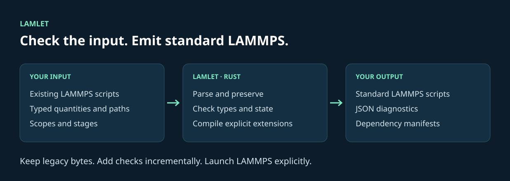
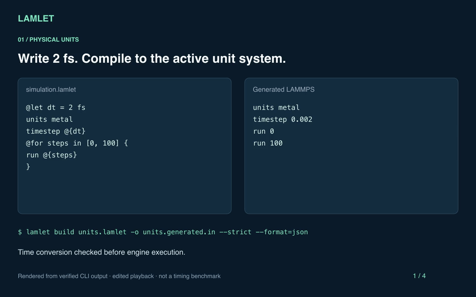

<p></p>

**Explicit, checkable simulation workflows for LAMMPS.**

Lamlet is a compiler and static checker written in Rust. It brings explicit
units, file dependencies, resource lifetimes, and stage contracts to existing
LAMMPS scripts. It emits ordinary LAMMPS scripts and deterministic JSON
diagnostics for editors and coding agents.

[Documentation](https://lan496.github.io/lamlet/) · [Gallery](docs/gallery.md) · [Quickstart](docs/getting-started.md) · [CLI reference](docs/reference.md) · [Design and limits](docs/design.md)



- **Keep your scripts.** Legacy input passes through byte-for-byte. Unsupported commands remain unverified.
- **Catch dimensional mistakes.** A temperature used as a timestep produces a source-located error before execution.
- **Declare resource lifetimes.** Scopes generate cleanup for managed fixes, computes, and dumps.
- **Make execution explicit.** Stages declare inputs and outputs and run in dedicated directories and fresh processes.
- **Work offline.** Checking and compilation need no LAMMPS installation, Python, or network. Typed input files must exist.

The recorded corpus has **1,075 byte-identical round trips and zero static rejections**
at pinned revisions. [Methods, exclusions, and partial coverage](docs/corpus.md).
A passing check means no implemented errors were detected. Scientific correctness
requires independent validation.

## See it in 32 seconds

[](docs/assets/demo.mp4)

[Watch or download the MP4](docs/assets/demo.mp4) · [Reproduce the demo](docs/demo.md)

The walkthrough uses verified CLI output with edited playback timing. It runs the
compiler; no molecular dynamics is executed.

## Start here

- [Gallery](docs/gallery.md): actual Lamlet and generated LAMMPS side by side, with reproducible line and character counts.
- [Presenter notes](demo/pitch.md): a 30-second introduction and three-minute spoken pitch.
- [The demo](demo/README.md): six verified CLI scenes and a standalone HTML presentation.
- [Getting started](docs/getting-started.md): build an existing script, add units, and compile two stage instances.
- [Agent evaluation](docs/agent-evaluation.md): six A/C pilot outcomes, published-artifact replay, and the proposed controlled study.
- [Harbor prototype](research/harbor/README.md): P1–P3 task preparation, separate verification, and an independent-oracle interface.

## Build and use

Install a stable Rust toolchain, then build the CLI:

```sh
cargo build --release --locked
./target/release/lamlet check examples/legacy.in
./target/release/lamlet build examples/legacy.in -o target/legacy.in
./target/release/lamlet build examples/typed.lamlet -o target/typed.in
```

The legacy output is byte-for-byte identical. The typed example emits
`timestep 0.002` from `2 fs` in metal units and unrolls two zero-step runs.
Both examples are standalone LAMMPS scripts after compilation. `check` and
`build` never invoke LAMMPS. `run` explicitly builds and launches the engine.

```lamlet
@let dt = 2 fs
units metal
timestep @{dt}
@for steps in [0, 100] {
    run @{steps}
}
```

For temperature and damping operand checking, see
[thermostat.lamlet](examples/thermostat.lamlet). It assumes `structure.data`
exists when LAMMPS runs. Lamlet does not open it.

## Use with an agent

```sh
./target/release/lamlet check examples/typed.lamlet --format json
./target/release/lamlet check examples/typed.lamlet --strict --format json
./target/release/lamlet schema --format json
./target/release/lamlet schema fix/nvt --format json
./target/release/lamlet build examples/typed.lamlet -o target/typed.in --source-map target/typed.map.json --format json
```

JSON output contains exactly one object. Exit codes are 0 for no detected
errors, 1 for validation errors, 2 for CLI or filesystem errors, and 3 for engine failures. Warnings and
unknown findings do not fail a compatible check. Strict mode requires schema
verification or an explicit `@unchecked{EXPR}` for newly interpolated operands.

Opaque commands weaken state knowledge. This includes ordinary commands whose
effects Lamlet has not modeled. Physical interpolation requires a known `metal`
or `real` unit style. See the [reference](docs/reference.md) and
[design decisions and limitations](docs/design.md) before using typed constructs
in a large legacy script.

## Resources and scopes

Use `path("...")` / `output("...")` through `@{...}` for checked file resources.
`lamlet inspect dependencies INPUT --format json` lists explicit dependencies.
`lamlet build INPUT` writes the configured build directory and an execution
manifest; `lamlet run INPUT` manages cwd and captures engine output. See the
[project guide](docs/resources.md) and [working example](examples/project/simulation.lamlet).

Use `@scope { ... }` with `@fix`, `@compute`, and `@dump` declarations for reverse
cleanup at block exit. `@drop ID` releases a resource early. Ordinary LAMMPS
resource commands retain manual lifetime management. See [scoped resources](docs/scopes.md)
for ownership, dependency, and control-flow restrictions.

The checker includes ten physical and idiom rules and 286 executable constraints
derived from a pinned LAMMPS manual. They check command ordering, numeric bounds,
averaging intervals, dimension and unit restrictions, pair options, and resource
state. Findings include source evidence, manual citations, and suggested actions.
They remain warnings in strict mode and never change the physical model.
Use `lamlet schema LML-MAN-NEIGHBOR-DELAY --format json` to inspect a rule.
The [generated catalog](docs/manual-rule-catalog.md) lists every new constraint.
The official manual index covers 1,001 source documents; conversion of the full
manual remains incomplete. See [lint rules and coverage](docs/lint-rules.md) and
[physical semantics](docs/semantics.md).

For a selected engine, `lamlet target inspect --format json` records compiled
packages/styles. Enable `[validation].check_capabilities` to check against that
saved profile without launching LAMMPS during compilation. Agents can query
`target list`, `target check`, `target explain`, and `target requirements`.
See [explicit targets](docs/capabilities.md) for configuration and plugin limits.

Same-source modules support typed calls and checked state contracts. Stages bind
typed inputs and outputs, build individually with `--stage`, and run in dedicated
directories and fresh processes. See the [stage example](examples/project/stages.lamlet)
and [syntax and contracts](docs/modules-and-stages.md). Checkpoint restoration,
workflow invocation graphs, and full provenance remain unimplemented.
The [programming model](docs/programming-model.md) explains the layer boundaries
and the design lessons drawn from Starlark, Nix, CUE, Modelica, and Koka.

## Verify changes

```sh
cargo fmt --all --check
cargo clippy --workspace --all-targets -- -D warnings
cargo test --workspace
```

The default suite uses no external engine. An optional ignored test compiles
both standalone examples and runs LAMMPS for zero steps:

```sh
cargo test -p lamlet-cli --test cli optional_lammps_zero_step_integration -- --ignored --exact
```

Set `LAMLET_LAMMPS_BIN` to choose a binary other than `lmp`. The optional test
requires a working local LAMMPS and MPI installation.

## Evaluate upstream compatibility

The optional corpus evaluator fetches pinned input scripts from LAMMPS and
LAMMPS Tutorials, measures byte preservation and static rejection separately,
and writes deterministic JSON with command frequencies and syntax inventories:

```sh
cargo build --release --locked
python3 tools/corpus.py fetch
python3 tools/corpus.py audit --inventory target/corpus/inventory.json
```

This development tool requires Git and Python 3.9+. Fetching requires network
access; it does not run simulations. The selected 893 official examples, 29
benchmarks, and 76 tutorial inputs all round-trip exactly and have no standard
or strict rejections at the pinned revisions. See the
[evaluation methods and results](docs/corpus.md) for exclusions, uncovered
negative cases, and reproduction details. The [baseline JSON](tests/corpus/baseline.json)
records the measured results; large local corpora and inventories stay ignored.

The original normative requirements are in [LAMLET_SPEC.md](LAMLET_SPEC.md).
The guides document subsequent requested extensions and their current boundaries.
