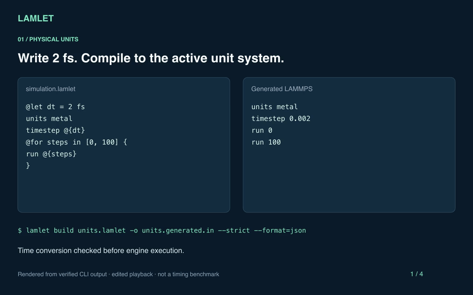

# Watch and reproduce the demo

The 32-second walkthrough shows unit conversion, a dimensional error, generated
resource cleanup, and preservation of a legacy script. It uses verified CLI
output with edited playback timing. It does not execute molecular dynamics.

<video controls preload="metadata" aria-label="Lamlet compiler walkthrough">
  <source src="assets/demo.mp4" type="video/mp4">
  <a href="assets/demo.mp4">Download the MP4 walkthrough</a>.
</video>

[Download the video](assets/demo.mp4) or view the animated preview:



## Reproduce the six CLI scenes

From the repository root:

```sh
cargo build --release --locked
python3 demo/run.py
```

Open `target/demo/index.html` for the complete presentation. The accompanying
`target/demo/report.json` records commands, exit codes, compiler identity,
generated scripts, and diagnostic evidence. The runner verifies all six scenes,
including the intentionally invalid examples.

## Regenerate the media

Install FFmpeg and librsvg so that `ffmpeg` and `rsvg-convert` are on `PATH`.
On macOS, Homebrew provides them with `brew install ffmpeg librsvg`.

```sh
python3 demo/render_media.py
```

This reads the verified report, renders SVG frames, and writes `demo.gif`,
`demo.mp4`, `overview.svg`, and an evidence manifest to `docs/assets/`.
The renderer fails if the required diagnostic or cleanup evidence changes.
Inspect the output before committing updated media.

The [presenter runbook](https://github.com/lan496/lamlet/blob/main/demo/README.md)
has the full sequence and a standalone HTML presentation.
