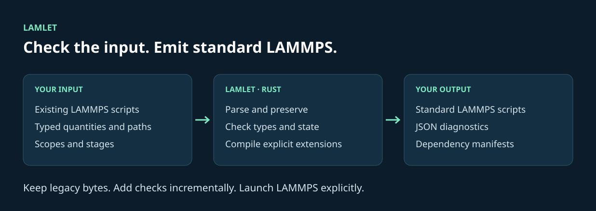

---
hide:
  - navigation
  - toc
---

# LAMMPS with units, resources, and structure.

<div class="lamlet-hero" markdown>

<span class="lamlet-eyebrow">LAMLET · RUST · v0.1</span>

Write the physics.<br>Check the input.
{ .lamlet-headline }

Lamlet compiles physical quantities, typed paths, and scoped resources into
ordinary LAMMPS scripts. Keep your existing inputs and add checks where you need them.
{ .lamlet-lead }

[Get started](getting-started.md){ .md-button .md-button--primary }
[Watch the demo](demo.md){ .md-button }
[View on GitHub](https://github.com/lan496/lamlet){ .md-button }

</div>

## Physical units in. LAMMPS numbers out.

<div class="lamlet-code-pair" markdown>

<div markdown>

**You write · simulation.lamlet**

```text
@let dt = 2 fs
units metal
timestep @{dt}
@for steps in [0, 100] {
    run @{steps}
}
```

</div>

<div markdown>

**LAMMPS receives · simulation.in**

```text
units metal
timestep 0.002
    run 0
    run 100
```

`check` and `build` work without LAMMPS.
Use `run` when you want to launch the engine.

</div>

</div>

## What does Lamlet check?

<div class="grid cards" markdown>

- **Physical quantities**

    A timestep accepts a time quantity. `timestep @{300 K}` produces
    `E_DIMENSION_MISMATCH`, with the source location and a suggested correction.

    [Units and expressions](reference.md)

- **Files and resources**

    Resolve typed input files before execution, enumerate dependencies, and
    distinguish an input file from a directory or output destination.

    [Paths and projects](resources.md)

- **Resource lifetimes**

    Declare `@fix`, `@compute`, and `@dump` inside `@scope`. Lamlet emits cleanup
    in reverse order and checks managed references.

    [Scoped resources](scopes.md)

- **Independent stages**

    Build a selected stage with explicit arguments, a dedicated working
    directory, and an execution manifest.

    [Modules and stages](modules-and-stages.md)

</div>

## Adopt it one script at a time

Start with an existing `.in` file. Lamlet preserves its bytes and accepts
commands outside its partial schemas as unverified. Then add units, typed paths,
or structured scopes to the parts you want checked.



The recorded compatibility corpus contains **998 inputs** at pinned revisions.
All 998 round-trip byte-for-byte, with zero standard or strict rejections.
This measures preservation and false rejections on that corpus.
[Read the scope and reproduction procedure](corpus.md).

## Built for a check, repair, repeat loop

```sh
lamlet check simulation.lamlet --format json
```

One JSON object, stable diagnostic codes, source spans, and explicit exit codes
let an agent inspect a problem and check its repair. Dependencies, command
schemas, stage manifests, and target capabilities are also available as JSON.
[Read the CLI reference](reference.md).

!!! note "What a passing check means"
    Lamlet reports errors within its implemented checks. Unsupported legacy
    commands remain unverified. A passing check does not establish scientific
    correctness, convergence, or successful execution. See the
    [current limitations](design.md) and [independent evaluation plan](agent-evaluation.md).
